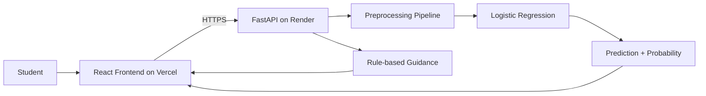

# Placify

**Student Placement Prediction & Career Guidance**
*Your Career Starts With Understanding Your Profile.*

## Overview
Placify is a full-stack educational machine-learning app. A Logistic Regression pipeline trained on a Kaggle placement dataset classifies a student profile as `Placed` or `NotPlaced`, and rule-based guidance suggests up to three focus areas.

## Problem Statement
Students often find it difficult to understand how different aspects of their academic and career profile relate to historical placement outcomes.

## Features
Multi-step profile form, real model prediction with probability, profile overview bars, rule-based career guidance, model insights (accuracy, precision, recall, F1, confusion matrix), and an educational "How It Works" page.

## Dataset
`placementdata.csv`: 10,000 rows, 12 columns, no missing values. Target `PlacementStatus`: Placed 4,197, NotPlaced 5,803 (verified by `train_model.py`). The raw CSV is git-ignored; place it at `backend/data/placementdata.csv` to retrain.

## Dataset Features
`CGPA`, `Internships`, `Projects`, `Workshops/Certifications`, `AptitudeTestScore`, `SoftSkillsRating` (3.0 to 4.8), `ExtracurricularActivities` (Yes/No), `PlacementTraining` (Yes/No), `SSC_Marks`, `HSC_Marks`. `StudentID` is an identifier and is never used.

## Machine Learning Approach
Binary classification, evaluated on a stratified 80/20 split (`random_state=42`). Metrics come from the held-out test set only.

## Preprocessing
`StandardScaler` on the 8 numeric features and `OneHotEncoder(handle_unknown="ignore")` on the 2 categorical ones, inside one scikit-learn `Pipeline` together with the classifier, so inference applies identical preprocessing.

## Logistic Regression
`LogisticRegression(random_state=42, max_iter=1000)`. Probabilities are mapped to the predicted class through `model.classes_`, never by assuming index 1 is `Placed`.

## Evaluation
Test-set results from the last training run (see `backend/model/evaluation.json`):

| Metric | Value |
|---|---|
| Accuracy | 80.85% |
| Precision (Placed) | 76.95% |
| Recall (Placed) | 77.59% |
| F1 (Placed) | 77.27% |

Confusion matrix (rows actual, columns predicted; NotPlaced, Placed): `[[966, 195], [188, 651]]`.

## Architecture


## Tech Stack
React, Vite, Tailwind CSS, React Router, Lucide icons; FastAPI, Pydantic, scikit-learn, pandas, numpy, joblib.

## Project Structure
```
placify/
├── backend/   main.py, train_model.py, schemas/, services/, model/, tests/
├── frontend/  src/{components,pages,services,hooks,utils}
├── render.yaml
├── .env.example
└── README.md
```

## Local Setup
### Backend Setup
```bash
cd backend
python -m venv .venv && source .venv/bin/activate
pip install -r requirements-dev.txt
python train_model.py          # optional: retrains and rewrites backend/model/
uvicorn main:app --reload --port 8000
pytest
```
### Frontend Setup
```bash
cd frontend
cp .env.example .env
npm install
npm run dev      # http://localhost:5173
npm run build
```

## Environment Variables
| Variable | Where | Example |
|---|---|---|
| `VITE_API_URL` | frontend | `http://localhost:8000` / `https://YOUR-BACKEND.onrender.com` |
| `FRONTEND_URL` | backend | `https://YOUR-FRONTEND.vercel.app` |

## API Endpoints
- `GET /health` returns `{"status": "ok"}`
- `GET /model-info` returns model name, algorithm, dataset size, feature count, accuracy, split
- `GET /model-evaluation` returns precision, recall, F1, confusion matrix, classification report
- `POST /predict` returns `prediction`, `probability`, `model_accuracy`, `focus_areas`

## Model Training
`python backend/train_model.py` prints dataset checks and metrics and writes `placement_model.joblib`, `model_metadata.json` and `evaluation.json`. Commit the regenerated artifacts so Render can serve them.

## Deployment
Push to GitHub, deploy the backend first, then the frontend.

### Render
1. New → Blueprint (uses `render.yaml`) or Web Service with root `backend`.
2. Build: `pip install -r requirements.txt`. Start: `uvicorn main:app --host 0.0.0.0 --port $PORT`.
3. Set `FRONTEND_URL` to your Vercel URL (no trailing slash). Free instances sleep when idle, so the first request can be slow.

### Vercel
1. Import the repo, set **Root Directory** to `frontend` (framework: Vite).
2. Set `VITE_API_URL` to your Render URL.
3. Deploy. `vercel.json` rewrites all routes to `index.html` for client-side routing.

## Limitations
Historical data may not represent all students. Dataset patterns do not guarantee future placement outcomes. Model performance depends on the dataset. Test-set accuracy is not the same as real-world employment accuracy. Use it for educational exploration, not high-stakes decisions. Input ranges in the dataset are narrow (for example CGPA 6.5 to 9.1), so profiles far outside them are extrapolations.

## Disclaimer
This is an educational machine-learning project. Predictions are based on patterns learned from the provided historical dataset and should not be treated as a guarantee of employment or as professional career advice. Model accuracy is measured on a held-out test dataset and does not guarantee the same performance on future students or real-world hiring outcomes.

## Future Improvements
Resume analysis, skill-gap analysis, job-role recommendations, prediction history, student dashboard, PDF career report, SHAP explainability, model comparison, additional datasets, college-specific analytics.
